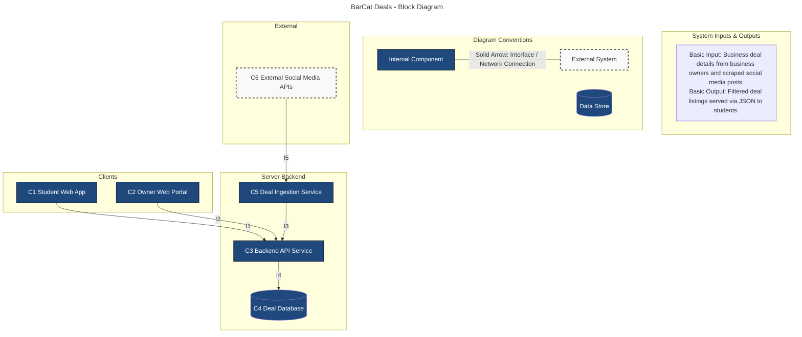
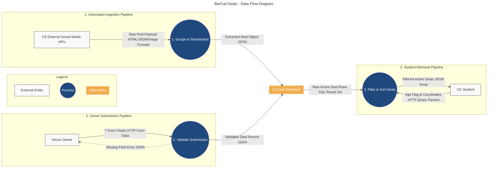

# D0 High-Level Design

#### Team Members:
- Brian Nguyen
- Kaustubh Mathur
- Ved Sanap
- Meredith Bartel
- Kiki Vasilev

## Block Diagram



**Goal Statement:** Create an easier way for UC students to view deals at bars and restaurants.

### Component Responsibility Table

| Component                      | Responsibility                                                                                                                            | Interfaces (In/Out)               | Primary Owner   |
| :----------------------------- | :---------------------------------------------------------------------------------------------------------------------------------------- | :-------------------------------- | :-------------- |
| **Student Web App**            | Renders the primary user interface allowing UC students to view and filter daily deals based on their inputted age.                       | Out: `I1`                         | Brian Nguyen    |
| **Owner Web Portal**           | Provides a form for Clifton bar and restaurant owners to manually submit their 7 required deal details directly to the platform.          | Out: `I2`                         | Kaustubh Mathur |
| **Backend API Service**        | Acts as the central server to validate incoming owner deals, retrieve database records, and filter alcohol promotions for underage users. | In: `I1`, `I2`, `I3`<br>Out: `I4` | Ved Sanap       |
| **Deal Database**              | Stores all active and historical deal records, venue details, and the timestamp of when each deal was last checked.                       | In: `I4`                          | Meredith Bartel |
| **Deal Ingestion Service**     | Scrapes external social media to extract deal information automatically and standardize it for the central database.                      | In: `I5`<br>Out: `I3`             | Kiki Vasilev    |
| **External Social Media APIs** | Provides the raw, unstructured posts and event data from local venues that the system relies on for automated deal generation.            | Out: `I5`                         | External (N/A)  |

### Interface Specification Table

| Interface ID                                  | Inputs & Outputs                                                                                                                             | Data Format | Protocol            | Error Handling                                                                                                                |
| :-------------------------------------------- | :------------------------------------------------------------------------------------------------------------------------------------------- | :---------- | :------------------ | :---------------------------------------------------------------------------------------------------------------------------- |
| **I1: Student Web App ↔ Backend API**         | **In:** User age boolean, location radius.<br>**Out:** Array of active deals sorted by time.                                                 | JSON        | REST (GET)          | **Student Web App** handles HTTP 500 by displaying a fallback "Unable to load deals" UI.                                      |
| **I2: Owner Portal ↔ Backend API**            | **In:** 7 required items (business name, address, deal description, category, times, alcohol bool, email).<br>**Out:** Success confirmation. | JSON        | REST (POST)         | **Backend API** handles missing fields (HTTP 400), returning the empty item's name; **Owner Portal** displays the error text. |
| **I3: Ingestion Service ↔ Backend API**       | **In:** Standardized scraped deal object.<br>**Out:** DB insertion status.                                                                   | JSON        | REST (POST)         | **Ingestion Service** retries up to 3 times on a timeout, then logs the failure and drops the payload.                        |
| **I4: Backend API ↔ Deal Database**           | **In:** SQL insert/select commands.<br>**Out:** Query result sets (deal rows).                                                               | SQL         | Database Connection | **Backend API** alerts the monitoring dashboard upon connection loss and serves cached deals if available.                    |
| **I5: Social Media APIs ↔ Ingestion Service** | **In:** Venue account ID.<br>**Out:** Raw post data (text, images, timestamps).                                                              | JSON        | REST (GET)          | **Ingestion Service** skips the venue and flags it as "possibly out of date" if the API rate limits or blocks the request.    |

Example payload for **I3: Ingestion Service ↔ Backend API**
```JSON
{
  "source_platform": "Instagram",
  "source_account": "@cliftonpub_cincy",
  "source_post_id": "180239481029384",
  "extracted_deal": {
    "business_name": "Clifton Pub",
    "address": "123 Calhoun St, Cincinnati, OH 45219",
    "deal_description": "$2 Tacos and $4 Margaritas",
    "category": "Food & Drinks",
    "days_and_times": "Tuesdays 4:00 PM - 9:00 PM",
    "alcohol": true,
    "confidence_score": 0.94
  },
  "scraped_at": "2026-10-02T14:30:00Z"
}
```

## Data-Flow Diagram



**Goal Statement:** Create an easier way for UC students to view deals at bars and restaurants.
## Architecture Pattern Selection

Our application will use the client-server architecture.

* **Client-Server Pattern:** The **C1 Student Web App** and **C2 Owner Web Portal** act as independent clients sending HTTP requests to the **C3 Backend API Service** and **C4 Deal Database**.
### Pattern Justification

| Criteria                 | Justification                                                                                                                                                                                                                                                                                                                                          |
| :----------------------- | :----------------------------------------------------------------------------------------------------------------------------------------------------------------------------------------------------------------------------------------------------------------------------------------------------------------------------------------------------- |
| **Fit to the Problem**   | **Client-Server** maps directly to a two-sided platform where students need access to deal data while owners submit forms independently. **Pipeline** fits the ingestion workflow where unstructured social media posts must pass through sequential transformation steps (scraping $\rightarrow$ parsing $\rightarrow$ standardizing) before storage. |
| **Team Skills**          | **Client-Server** uses familiar REST/HTTP endpoints and SQL database queries. **Pipeline** allows isolated development of the scraping/parsing logic without risking core database operations.                                                                                                                                                         |
| **Performance & Timing** | **Client-Server** allows the student app to quickly query indexed database views for real-time feed rendering. The **Pipeline** runs asynchronously in the background, ensuring expensive web scraping does not slow down user API responses.                                                                                                          |
| **Scalability**          | The backend API server and database can scale independently to handle peak evening traffic spikes from students, while ingestion worker threads scale separately based on scraping frequency.                                                                                                                                                          |
| **Hardware Constraints** | This application does not use hardware besides requiring a computer to run the application. This can be delegated to cloud-hosting services like AWS and Azure.                                                                                                                                                                                        |

### Rejected Pattern & Rationale

Rejected Pattern: Microservices Architecture
* **Rationale:** Microservices architecture could make our application easier to manage in the future as everything is decoupled. However, our current diagram layout shows that it's not large enough to justify this pattern. This pattern solves a problem that doesn't exist and may introduce more issues if it were implemented.

## Decision Log

| Decision                                                                                                  | Alternatives Considered                                                       | Rationale / Why                                                                                                                                                      |
| :-------------------------------------------------------------------------------------------------------- | :---------------------------------------------------------------------------- | :------------------------------------------------------------------------------------------------------------------------------------------------------------------- |
| Use a hybrid data strategy combining automated social media scraping and direct manual owner submissions. | 1. 100% automated scraping<br>2. 100% manual portal submissions               | Scraping ensures quick initial coverage across Clifton venues, while the owner portal guarantees high accuracy for key venues that rarely post structured deal data. |
| Implement client-side age filtering by backend boolean flags (`alcohol: true/false`).                     | 1. Mandatory ID verification upload<br>2. Restricting underage users entirely | An age toggle/flag respects student privacy without friction, while strict API filtering guarantees 21+ alcohol deals are omitted for underage users.                |
| Host database records on a cloud database.                                                                | 1. HTTP-based serverless DB wrapper<br>2. Self-hosted local database instance | Having a cloud service provider manage the database reduces the work needed for our team.                                                                            |
| Use decoupled REST APIs over HTTP/JSON for communication between clients and the central backend service. | 1. WebSockets<br>2. GraphQL                                                   | REST endpoints are simple to implement, lightweight, and perfectly suited for simple request-response payloads (fetching deal lists and submitting forms).           |
| Implement automated retry logic with a drop fallback for the Web Scraping / Ingestion Service.            | 1. Blocking API calls until DB success<br>2. Manual error review queue        | Retrying up to 3 times prevents network failures from dropping scraped data, while dropping stale payloads prevents pipeline bottlenecks.                            
