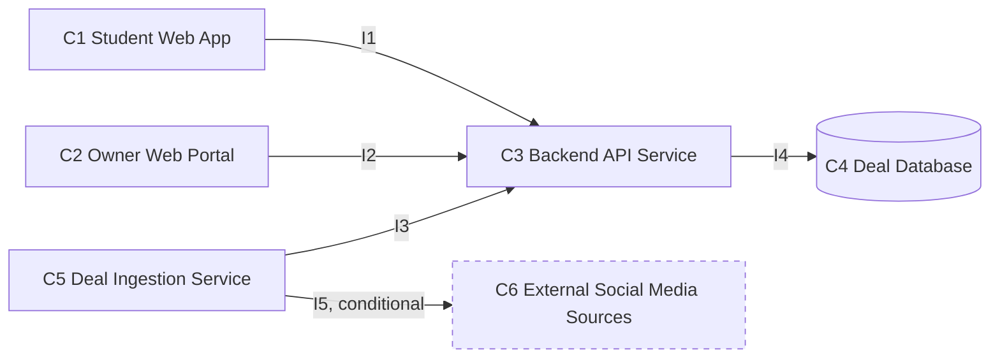
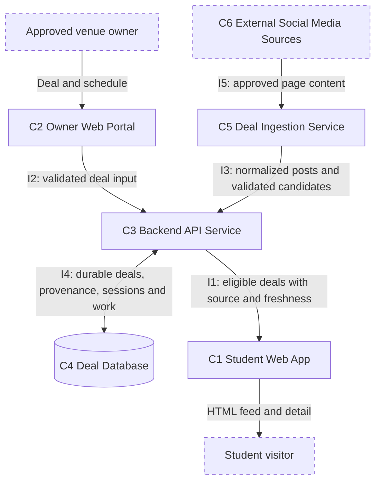

# D0 High-Level Design

BarCat Deals · CS 5001 Senior Design I · November 23, 2026

Brian Nguyen, Kaustubh Mathur, Ved Sanap, Meredith Bartel, Kiki Vasilev

This view reconciles the Week 5 topology with [D2](D2_Detailed_Design.md), the [Requirements Document](../Requirements_Document.md), and the [Technical Specification](../Technical_Specification.md). The [original Week 5 design](https://github.com/BrianN45/Senior-Design/blob/53a1aa7/Assignments/Assignment-5/Diagrams/high-level-design.md) records how the project started.

## Block Diagram

Rectangles denote components, the cylinder denotes persistent storage, and the dashed outline denotes an external dependency. Arrows point from the caller to the callee. G1-G4 are shared modules inside the components.

| Interface | Contract |
| --- | --- |
| I1, C1 to C3 | HTTPS/JSON feed, detail and guest session requests. C3 calculates today's Eastern occurrences within the fixed campus radius and enforces eligibility before serialization. |
| I2, C2 to C3 | HTTPS/JSON with verified owner session and request key. C3 checks the venue mapping and seven required form items, then returns success after an atomic commit. |
| I3, C5 to C3 | Restricted HTTPS/JSON for registering posts, leasing work, reserving budget and completing work. Failed posts remain available for recovery. |
| I4, C3 to C4 | SQL through the API service, including migrations, reads and transactions. C3 alone has direct application access to C4. |
| I5, C5 to C6 | HTTPS to approved venue pages. C5 normalizes posts and handles throttling or denied access. Approval and funding gate collection. |

## Data-Flow Diagram

Here arrows follow the data. The direct owner path works independently of source collection and AI. C3 serves typed errors for failed calls, while C1 and C2 render accessible inline notices. For component ownership and the requirement-to-test matrix, see [Design Report Section 3](../README.md#3-user-stories-and-design-diagrams).

## Architecture Decisions

- Retain D0's client-server architecture and background ingestion pipeline. Flask clients call one FastAPI service so C3 can enforce the same rules on every path.
- Store the age answer in a server-held guest session. Store deal data and provenance in PostgreSQL. Use bounded, durable retries through C3 for ingestion.
- Use the [Technical Specification interfaces](../Technical_Specification.md#3-interfaces-and-data-formats) for message formats, error codes and timing conditions.
