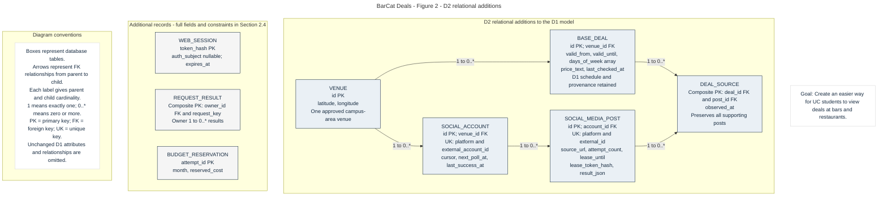
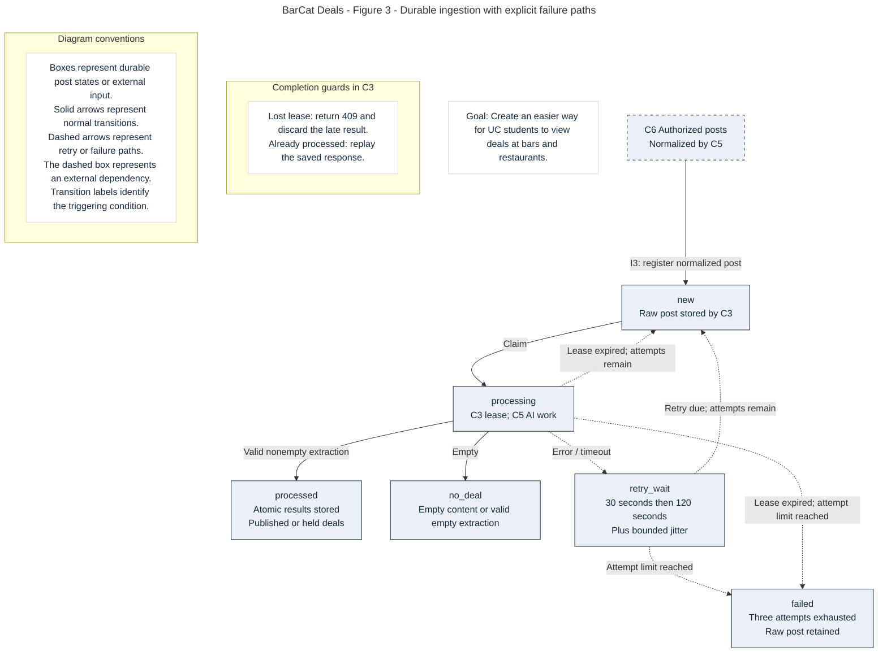

# BarCat Deals: Detailed Design (D2)

**Team Members:** Brian Nguyen, Kaustubh Mathur, Ved Sanap, Meredith Bartel, Kiki Vasilev  
**Course:** CS 5001 Senior Design I  
**Advisor:** Dr. Hrishikesh Vinayak Bhide  
**Assignment:** Design D2 - Detailed Design
**Date:** October 14, 2026  
**Document Version:** 1.2

---

# 1. Header, Conventions, and D2 Overview

## Project Title

**BarCat Deals**

## Goal Statement

BarCat Deals gives University of Cincinnati students an easier way to find deals around campus. By using AI, the system automatically finds deals in businesses' social media posts, and business owners can also submit their own deals. Students can search deals that are active right now and save the ones they like.

## Scope and D2 Overview

D0 defines six components and interfaces I1 through I5. D1 details the Backend API Service C3, Deal Database C4, and Deal Ingestion Service C5. D2 finishes the Student Web App C1, Owner Web Portal C2, and the boundary to External Social Media APIs C6. It also specifies authentication, notifications, configuration, and logging, and closes gaps between D1 and the Week 4 acceptance criteria. C3 remains the only application component allowed to read or write C4.

The selected stack remains Flask and Jinja for C1 and C2, FastAPI and Python for C3 and C5, PostgreSQL for C4, and Azure hosting. The shared services in this document are modules within those components, not additional microservices. The design and acceptance checks below are implementation specifications, not claims that the application has already been built or tested.

## 1.1 Diagram Conventions

* C1 to C6 and I1 to I5 retain their D0 identities. G1 to G4 identify shared modules introduced here.
* Figure 1 shows request flow, Figure 2 shows the data additions, and Figure 3 shows ingestion states and failures. Every figure includes the project title, the D0 goal, and its own legend.
* Solid arrows show normal flow or relationships; dashed arrows show errors in flow figures. Data relationships use labeled cardinalities.
* `PK` identifies a primary key, `FK` identifies a foreign key, and `UK` identifies a unique key.
* All stored instants are UTC timestamps. Schedules and displayed dates use `America/New_York`, with Monday numbered 1 and Sunday 7.
* Time intervals include their start and exclude their end.
* IDs are opaque strings of 1 to 128 characters.
* Unless stated otherwise, new limits and operating intervals are proposed engineering defaults to validate during implementation.
* Requirement IDs from `User_Stories` are preserved; derived constraints and deferred D1 features are labeled separately.

## 1.2 Known Gaps and Open Questions

| ID | Open item | Owner and resolution before release |
| --- | --- | --- |
| OQ-01 | Permission and cost to read each venue account through Meta or X are not established. | Kiki: demonstrate one permitted account fetch per enabled adapter. Disable unapproved adapters; owner submission remains usable. No assumed access to arbitrary public posts. |
| OQ-02 | The campus reference coordinate and venue coordinates need approval. | Meredith: seed and verify coordinates; Brian: approve the reference point. Use a one-mile straight-line radius as the D2 interpretation of AC-01.1. |
| OQ-03 | Many source posts omit a price. The seven required owner items also do not explicitly require one. | Kaustubh: confirm the price policy with stakeholders. Display a supplied price or the text “Price not provided”; never invent a price. AC-01.1 data completeness remains conditional. |
| OQ-04 | Azure, identity-provider, and AI spending limits and extraction quality are unmeasured. | Ved and Kiki: set a funded monthly cap, verify service terms, and evaluate labeled posts before enabling automation. Default AI publication off until the evaluation passes. |
| OQ-05 | The project has no accepted criterion for bookmarks or a moderation dashboard. | Team: defer these D1 features from the MVP. Pending automated records remain hidden; correcting and reprocessing the source is the initial recovery path. |

---

# 2. Finished Components, the D2 Diagrams

## 2.1 Component Completion and Interface Boundaries

The primary owners below follow D0. Shared-module ownership is a proposed implementation allocation. The biographies support using Python and SQL across the services and separating frontend, integration, and testing work; they do not establish that every selected framework is already familiar to every teammate.

| Element | Data model | Behavior and interface | Primary owner |
| --- | --- | --- | --- |
| C1 Student Web App | No persistent data in C1; page view model and cookie reference only | Browse and detail flow in 2.2; I1 public API in 2.6 | Brian Nguyen |
| C2 Owner Web Portal | No persistent data in C2; current form and request key | Validate and submit flow in 2.3; I2 owner API in 2.6 | Kaustubh Mathur |
| C3 Backend API Service | D1 entities plus Figure 2; transient request DTOs | Eligibility and transaction algorithms in 2.5; I1 to I4 | Ved Sanap |
| C4 Deal Database | D1 relational model plus 2.4 | Constraints, transactions, migrations, and recovery in 2.4; I4 | Meredith Bartel |
| C5 Deal Ingestion Service | Durable work state in C4 through C3; transient fetched page | Normalize, extract, and acknowledge in 2.7; I3 and I5 | Kiki Vasilev |
| C6 External Social Media APIs | Provider-owned data; no application-owned persistent data in C6 | Read-only provider adapter boundary in 2.7; I5 | External; Kiki owns adapters |
| G1 Authentication and authorization | WEB_SESSION plus owner and student identity mapping | Guest age session, verified login, authorization; 2.8 | Ved Sanap |
| G2 Notifications | No persistent data; response-derived notices | Accessible inline status and error notices; 2.9 | Brian Nguyen |
| G3 Configuration | Versioned nonsecret deployment settings and secret references | Validate configuration at startup; 2.9 | Kiki Vasilev |
| G4 Logging and health | Structured events in the hosting log store | Redact, record, and monitor; 2.9 | Meredith Bartel |

| Interface | D2 boundary and revision | Failure owner |
| --- | --- | --- |
| I1 C1 to C3 | HTTPS JSON; filters and an opaque session token in a header. Age is read from server state. Today and active modes are separate. Responses include price, distance, source, and freshness. | C3 returns typed errors; C1 renders them. |
| I2 C2 to C3 | HTTPS JSON; seven logical form items plus structured schedule. The authenticated owner determines venue identity. A request key makes retries safe. | C3 validates atomically; C2 preserves form values. |
| I3 C5 to C3 | HTTPS JSON; raw-post registration, work claim, result completion, and failure reporting are separate operations. C5 never receives database credentials. | C5 retries transport errors; C3 owns leases and durable results. |
| I4 C3 to C4 | Parameterized SQL through SQLAlchemy; transactions return domain records rather than exposing SQL to clients. | C3 rolls back; G4 records dependency failure. |
| I5 C5 to C6 | Provider HTTPS API behind `fetch_posts`; normalized posts hide provider-specific payloads and pagination. | C5 handles throttling and authorization failure. |

These revisions replace D0's client-supplied age flag, direct-to-database ingestion arrows, and payload-dropping fallback. They also refine D1's active-only search. D0 and D1 remain historical design documents; the implementation uses D2 where the contracts differ. The API is not yet released, so these are preimplementation changes to `/api/v1`; after release, incompatible changes require `/api/v2` as described in D1.

## 2.2 C1 Student Web App

```mermaid
---
title: BarCat Deals - Figure 1 - Student browsing and owner submission
---
flowchart TD
    goal["Goal: Create an easier way for UC students to view deals at bars and restaurants."]

    subgraph student_flow["Student browsing"]
        student["C1 Student Web App<br/>Age answer and today filters"]
        eligibility["C3 Eligibility on I1<br/>Server age, radius, and schedule<br/>Order by occurrence start"]
        feed["C1 Accessible feed and detail<br/>Eligible cards and source links<br/>Freshness labels and error text"]

        student -->|"I1 GET"| eligibility
        eligibility -->|"200 / eligible results"| feed
        eligibility -.->|"401 / 403 / 503: show error"| feed
    end

    subgraph owner_flow["Owner submission"]
        owner["C2 Owner Web Portal<br/>Owner login and seven-item form"]
        validation["C3 Validation on I2<br/>Owner mapping and request key<br/>Validate before write"]
        transaction["C4 Transaction on I4<br/>Deal and request result commit<br/>Then confirm success in C2"]

        owner -->|"I2 POST"| validation
        validation -->|"Valid / commit"| transaction
        validation -.->|"401 / 422 / 503"| owner
    end

    subgraph legend["Diagram conventions"]
        conventions["Boxes represent steps or components.<br/>Solid arrows represent normal requests and results.<br/>Dashed arrows represent errors.<br/>I1, I2, and I4 preserve the D0 interface names."]
    end

    classDef component fill:#eaf0f5,stroke:#172b40,color:#172b40;
    classDef note fill:#ffffff,stroke:#d9d9d9,color:#172b40;
    class student,eligibility,feed,owner,validation,transaction component;
    class goal,conventions note;
```



**Figure 1.** The student and owner clients share C3 authorization and validation. Failures return to the initiating page; only a committed owner transaction leads to success. Editable Mermaid source: [D2-client-flow.mmd](Diagrams/Diagram-Code/D2-client-flow.mmd).

### Data Model

`FeedView` contains `selected_date`, filters, `data: DealView[]`, `next_cursor`, `generated_at`, `last_updated_at`, `stale_count`, and `age_confirmed`. `DetailView` contains one DealView. These objects exist only for the current request. Neither HTML nor browser storage contains a second authoritative copy of age or authorization state.

### Purpose

Algorithm C1 lets students browse eligible deals and inspect their details.

### Inputs and Outputs

Input is a browser request with optional filters and the application session cookie. Output is an HTML feed, detail page, or an accessible error page.

### Approach

1. On the first visit, show the age question and an available nonalcohol feed. Dismissal and “under 21” leave alcohol disabled. “21 or older” creates or updates a server session through G1; it does not require an account.
2. Request `GET /api/v1/deals` with `mode=today`, today's Eastern date, a fixed campus radius of one mile, and `sort=start_time`. After confirmation, set `include_alcohol=true`. The API independently checks the session.
3. Render venue, offer, price text, schedule, and last-checked time for every returned card. Provide a labeled next-page link until `next_cursor` is null so all matching deals are reachable. Show food as a prominent filter without changing the required start-time ordering.
4. Display the dataset's last update above the feed. Mark every deal checked more than 24 hours ago “Possibly out of date”; a null check time means “Never verified.” Staleness alone never removes an otherwise eligible deal.
5. A detail link requests `GET /api/v1/deals/{deal_id}`. Render the same eligibility rules and a labeled original-post link for automated deals. Owner submissions display “Submitted by venue” instead of an invented source link.
6. Revalidate on navigation and every 60 seconds while the page is visible. A failed refresh may retain already rendered nonalcohol cards with a failure notice, but hides alcohol cards until eligibility is revalidated. `401` or `403` clears the alcohol view immediately. Never replace failure with an empty success list.

### Accessibility

Use semantic headings, lists, labels, real links and buttons, visible focus, a skip link, and text error summaries linked to fields. Deal information is text rather than text embedded in flyer images. Announce status changes in a polite live region and submission errors in an alert region. Avoid automatic focus changes during refresh. Templates escape user text, and source links accept HTTPS URLs only. AC-04.1 requires axe-core scans on both feed and detail pages with zero serious and critical findings; keyboard and screen-reader checks supplement that scan.

### Complexity

Rendering is O(p) for p displayed deals, at most 50 per page.

### Why This Approach

Server-rendered templates preserve D1's Flask choice and avoid a separate SPA state store. The trade-off is a page request for most interactions. CSS and scripts are served with the application so a third-party asset outage does not make the feed unusable.

### Edge Cases

Age confirmation and dependency failures are covered by EC-01 and EC-08 in Section 3. Empty results, pagination, and failed refreshes are handled in the approach above.

## 2.3 C2 Owner Web Portal

### Data Model

`OwnerDealForm` holds business name, address, description, category, structured days and times, alcohol yes/no, and contact email. Business name, address, and email are prefilled from the approved owner and venue records and must be nonempty. Price text and title are optional additions. Form values remain in the current response after an error; no separate form-storage database is introduced.

### Purpose

Algorithm C2 validates and publishes an owner-submitted deal without duplicate or partial writes.

### Inputs and Outputs

Input is the seven logical required items plus session and request key. Output is a confirmation with a deal ID or field-specific errors with zero committed deals.

### Approach

1. Require a verified owner login with a preprovisioned `BUSINESS_OWNER.venue_id`. Initial ownership verification and coordinate entry are performed by the team during onboarding; self-service venue claiming is outside the MVP. Unapproved owners cannot publish.
2. Show required fields, a seven-day selector, start and end times, optional effective dates, and an optional price field. If title is omitted, C3 derives it from the first 120 characters of the description. The description is never replaced by that shortened title.
3. Validate required values, field lengths, enum values, and schedule boundaries in the portal for feedback, then repeat validation in C3. Empty or invalid input returns `422` with field names. A mismatched venue name or address returns a profile-mismatch error, not a write to another venue. Owners correct profile data through onboarding support.
4. Generate a UUID request key when the form is first presented. Reuse it after a timeout or retry of unchanged content. C3 scopes it to the owner, compares a canonical body hash, and commits the base deal, submitted subtype, and stored response in one transaction.
5. Return `201` only after commit, followed by a confirmation and detail link. Matching repeated requests return the original status and body. A different body under the same key returns `409`; corrected content gets a new key. A distinct key for the same canonical offer returns `409` with the existing deal ID.
6. Published owner records are available immediately to a new eligible feed request. Existing open feeds refresh within 60 seconds. Measure submit-to-visible latency against AC-03.1; a future or out-of-radius deal is stored but displayed only when it matches the selected feed.

### Complexity

Input work is O(n) in form length; duplicate comparison is O(k) in live venue deals.

### Why This Approach

The request key allows an unchanged submission to be retried without a duplicate insert. C3 locks the venue row during duplicate check and insert to serialize conflicting owner and automated writes.

### Edge Cases

A timeout shows “Submission status unknown; retry to check” rather than “not saved.” No automatic retry creates a new key. Database or authentication outages return an error while preserving the form. See EC-02 to EC-04 and EC-08 in Section 3.

## 2.4 C4 Data Additions and Invariants



**Figure 2.** D2 extends the D1 entities instead of replacing them. It adds session and request-result records, multiple social accounts per venue, source evidence, and worker leases. The diagram omits unchanged D1 attributes. Editable Mermaid source: [D2-data-model.mmd](Diagrams/Diagram-Code/D2-data-model.mmd).

| Entity or field | Type and rule | Why it is needed |
| --- | --- | --- |
| VENUE coordinates | `latitude` and `longitude`: decimal degrees, required before publication; latitude -90 to 90, longitude -180 to 180 | Enforces the one-mile rule without collecting student location. |
| BASE_DEAL schedule | `days_of_week`: smallint array of distinct 1 to 7; `valid_from`: date; `valid_until`: nullable date, not before valid_from | Corrects D1's scalar weekday diagram and prevents future offers appearing early. Dates bound occurrence start dates. |
| BASE_DEAL display | `price_text`: nullable string up to 120; `last_checked_at`: nullable UTC timestamp; `created_at` and `updated_at`: UTC | Supports price and freshness display; missing source facts remain explicit. |
| SOCIAL_ACCOUNT | `id` PK, `venue_id` FK, platform enum, `external_account_id`, `cursor`, `next_poll_at`, `last_success_at`, `enabled`; UK(platform, external_account_id) | Replaces VENUE's single account ID with one row per platform account. Credentials remain secret references outside public data. |
| SOCIAL_MEDIA_POST | Existing D1 fields plus `account_id` FK, `source_url`, `attempt_count`, `lease_token_hash`, `lease_until`, `next_attempt_at`, `last_error_code`, `result_json` | Holds durable work, retries, original link, and replay results. UK(source_platform, external_id), not external_id alone. |
| DEAL_SOURCE | `deal_id` FK, `post_id` FK, `observed_at`; composite PK(deal_id, post_id) | Preserves all supporting posts when repeated offers merge. One post can support multiple deals. |
| WEB_SESSION | `token_hash` PK, nullable `auth_subject`, role enum guest/student/owner, `age_boolean`, `csrf_hash`, `expires_at`, `revoked_at` | Supports guests without an account and revocable server-side authorization. Raw session tokens are never persisted. |
| Owner and student identities | Add unique `auth_subject` to BUSINESS_OWNER and STUDENT | Maps verified identity-provider subjects to application records. Owner privileges never come from request fields. |
| REQUEST_RESULT | Composite PK(owner_id, request_key), `body_hash`, `status_code`, `response_json`, `created_at`, `expires_at` | Replays owner submission results for 24 hours after commit. |
| BUDGET_RESERVATION | `attempt_id` PK, `month` YYYY-MM, `reserved_cost` nonnegative decimal, `created_at` UTC | C3 serializes monthly reservations against the configured cap before each AI attempt. Replays of an attempt do not reserve twice. |

All D1 deal subtype keys remain shared PK/FKs. Each base deal has exactly one provenance subtype, enforced by C3 and a deferred database constraint trigger at commit. Owner content wins over conflicting automated text; a merge may add source evidence but cannot silently change owner-entered price, schedule, or alcohol classification. Uncertain automated alcohol classification is treated as alcohol. A contradicting source is held for review.

The deal, subtype, evidence, and processed-post result are written atomically. On failure, no partial deal is published. Exact retry keys use unique constraints; fuzzy duplicate decisions lock the venue row before selecting candidates. Index published deals by `(status, venue_id)`, work by `(status, next_attempt_at, lease_until)`, all join FKs, session expiry, and request-result expiry. Keep D1's unique saved pair `(student_id, base_deal_id)` if the deferred bookmark feature is implemented. An alcohol-only index is not assumed sufficient because it has low selectivity; validate query plans with realistic data.

### Behavior and Interface

C3 owns connection pooling, migrations, and all parameterized SQL on I4. Queue claims use a short transaction with `FOR UPDATE SKIP LOCKED`; commit the lease before making a network or AI call. PostgreSQL documents this as suitable for queue-like consumers [T3]. Roll back on constraint or connection failure. Apply migrations once per deployment; failed migration means readiness fails. Proposed operations policy is daily managed backup, seven-day retention, and a restore exercise before release. These are targets, not verified hosting capabilities or a zero-data-loss guarantee.

## 2.5 C3 Search and Publication Behavior

### Purpose

Algorithm B2 returns eligible deals for the selected day or instant, with deterministic ordering and freshness information.

### Inputs and Outputs

Inputs are the query contract in 2.6 and a validated caller context. Output is a deterministic ordered page of DealViews and feed freshness metadata.

### Approach

1. Establish one server UTC `snapshot_at` for the request sequence and convert it to Eastern time. `mode=today` selects occurrences overlapping the requested local calendar day; `mode=active` selects occurrences containing `at`. The default is today, not active-only.
2. Select only `published` deals with approved venue coordinates. Evaluate the great-circle distance from the configured campus point; include distance less than or equal to 1,609.344 meters. D2 uses straight-line distance, not walking distance. Never accept a client radius that widens the MVP boundary.
3. Enumerate schedule start dates for the selected day and its previous day. A start date must satisfy its weekday, `valid_from`, and `valid_until`. If end time precedes start time, end is on the next day. Keep intervals overlapping the day, or containing `at` in active mode. This preserves an offer ending after midnight even when its final start date has passed.
4. Use timezone-aware conversion. For nonexistent spring-forward times, advance to the first valid local instant; for ambiguous fall-back times, choose the earlier start and later end. Reject equal start/end values. These explicit D2 policies replace relying on an unspecified library default.
5. Apply the server age gate before serialization. With no positive age confirmation, return only `alcohol=false`. If such a caller explicitly asks for alcohol, return `403`. Detail and saved-deal endpoints must use the same rule. Expired or unpublished details return `404`; an age-restricted published detail returns `403` without offer content.
6. In today mode sort by `(occurrence_start, deal_id)`; in active mode default to food first, then remaining minutes, then ID as in D1. `minutes_remaining` is the ceiling of positive seconds to the occurrence end divided by 60 in active mode; it is null in today mode. Pagination uses the sort key and ID, not row offsets.
7. Return each record's `last_checked_at` and `is_stale`. A record is stale when its check time is null or more than 24 hours before snapshot_at. `last_updated_at` is the maximum check time across all matching records, or null. `stale_count` covers that full result set, not just the current page. Always show the overall timestamp and mark stale cards individually; never imply one fresh card makes all others fresh.

The signed cursor contains mode, date or at, filter hash, sort, snapshot_at, and last sort key. It expires after five minutes. Reject altered cursors and mismatched filters with `422`. Snapshot_at freezes time calculations but is not a database snapshot: concurrent edits can change membership. C1 refreshes the first page after an owner submission or filter change; age authorization is rechecked on every page.

### Complexity

At D1's assumed 50 venues and 300 live deals, a venue scan and schedule filter are small. Worst-case candidate work is O(v + n), followed by O(n log n) sorting; do not claim a measured millisecond runtime. Test again at 100 times the volume. At larger scale, a spatial index or precomputed campus distance may be justified by measurements. Budget the under-three-second initial display as up to two seconds for I1 plus one second for transfer and rendering; measure the full browser path under an agreed network profile.

### Why This Approach

Separate today and active modes support the two browsing questions while retaining D1's explicit schedule fields and cursor pagination. The server applies age and location eligibility before returning deal content.

### Edge Cases

EC-01 and EC-05 to EC-08 cover age restrictions, distance and freshness boundaries, overnight schedules, invalid inputs, and dependency failures. Daylight-saving transitions and cursor expiry follow the policies above.

### Publication and Freshness

Owner submission sets `last_checked_at` at committed owner confirmation. Automated publication uses the observation time of evidence that was fetched and successfully validated; retrying old stored text must not make the deal appear freshly checked. Polling an account successfully does not refresh every old offer. Missing prices, uncertain dates, or absent source links place automated output in `pending_review`; no unsupported details are fabricated. The D1 confidence gates remain 0.70 for publication and 0.40 for review, subject to OQ-04 evaluation. A job expires a deal only after the end of its last permitted occurrence; query-time checks remain authoritative if that job is delayed.

## 2.6 Public API Contract

All endpoints use `/api/v1`, HTTPS, and JSON. Browser HTML routes in C1/C2 call these APIs; they do not expose provider tokens. API requests carry `X-Session-Token` when a session exists. State-changing browser forms also require a CSRF token. Malformed JSON returns `400`, invalid fields `422`, invalid authentication `401`, insufficient authority `403`, missing resources `404`, conflicts `409`, rate limits `429`, and unavailable dependencies `503`.

Every error is `{"error":{"code":string,"message":string,"fields":object},"request_id":string}`. `fields` maps field names to arrays of messages and is empty for nonfield errors. Messages do not contain tokens, SQL, raw provider bodies, or another owner's data. D1 clients must adapt to these preimplementation extensions.

| Endpoint | Input contract | Success and specific failure behavior |
| --- | --- | --- |
| GET /deals | `mode`: today or active, default today. Today accepts `date` YYYY-MM-DD, default Eastern today, through 14 days ahead. Active accepts `at` offset datetime, default now, from now through 14 days ahead. Reject date/at in the wrong mode. Optional `venue_id`, category food/drink/other, `include_alcohol` bool default false, `sort` start_time/default/ending_soon/venue_name, `limit` 1 to 50 default 20, cursor. | 200 FeedResponse. Today defaults to start_time; active defaults to default. ending_soon requires active mode. Venue-name sort ties by occurrence start and ID. 403 for unconfirmed alcohol request; 422 invalid combination/cursor; 503 database failure. |
| GET /deals/{deal_id} | ID and optional session. | 200 DealView for a published, in-radius offer with a current or future occurrence. Same age gate; 404 missing, expired, unpublished, or out of radius. |
| POST /owner/deals | Owner session; `Idempotency-Key`: UUID. Required business_name 1..160, address 1..300, contact_email valid and at most 254, deal_description 1..1000, category enum, alcohol bool, days_of_week array of unique integers 1..7, start_time and end_time HH:MM. Optional title 1..120, price_text 1..120, valid_from default today, valid_until nullable and at most one year ahead. | 201 `{deal_id,status:"published",published_at}` after commit. 403 unmapped owner; 409 duplicate or key/body conflict; 422 field/profile/schedule error; 503 transaction unavailable. Venue ID is never accepted in the body. |
| POST /sessions/guest | Empty JSON object; rate-limited. | 201 `{session_token,csrf_token,expires_at,age_confirmed:false}`. C1 stores session token only in a secure cookie and includes csrf_token in forms. 429 abuse limit; 503 storage failure. |
| PATCH /session/age | Current guest or student session; `confirmed_21_plus`: required bool. | 200 `{age_confirmed:bool}`; update server session and linked student flag atomically. 401 expired session; 403 owner-only role; 422 wrong type. False immediately removes eligibility. |
| POST /sessions/login | Verified identity-provider access token in Authorization bearer header. No role or venue field. | 201 `{session_token,csrf_token,expires_at,role,age_confirmed}` from server mapping. 401 invalid/expired identity; 403 unapproved owner; 503 provider verification unavailable. |
| DELETE /session | Current session. | 204 after revocation; repeating deletion is harmless. Browser clears the cookie. 503 if revocation could not be persisted. |

### DealView Response

D1's fields remain: deal_id; venue {venue_id, name, address}; title; deal_description; category; alcohol; source (owner or automated); days_of_week integer array; start_time; end_time; valid_until. Add `price_text:string|null`, `valid_from:date`, `distance_meters:number`, `source_url:string|null`, `last_checked_at:UTC|null`, `is_stale:bool`, `occurrence_start:offset datetime`, `occurrence_end:offset datetime`, and `minutes_remaining:int|null`. Detail chooses the earliest not-yet-ended occurrence and uses null minutes_remaining. For merged automated deals, source_url is the most recently validated supporting post. Public DTOs exclude owner contact email, confidence, tokens, and worker internals.

### FeedResponse

`{data:DealView[], next_cursor:string|null, generated_at:UTC, last_updated_at:UTC|null, stale_count:int}`. `generated_at` is the actual response-generation time; cursor snapshot_at governs eligibility and staleness consistently across pages. On the first page they are captured together. An empty result is `200`, an empty data array, null next_cursor and last_updated_at, and stale_count 0.

### Example Request and Response

The following request and response use illustrative records:

```http
GET /api/v1/deals?mode=today&date=2026-10-14&limit=20
Accept: application/json
```

```json
{
  "data": [{
    "deal_id": "d_0412",
    "venue": {"venue_id": "v_07", "name": "Example Cafe", "address": "Example campus address"},
    "title": "$2 tacos", "deal_description": "$2 tacos on Wednesday",
    "category": "food", "alcohol": false, "source": "owner",
    "days_of_week": [3], "start_time": "16:00", "end_time": "21:00",
    "valid_from": "2026-10-14", "valid_until": "2026-10-14",
    "price_text": "$2 each", "distance_meters": 500,
    "source_url": null, "last_checked_at": "2026-10-14T14:00:00Z",
    "is_stale": false, "occurrence_start": "2026-10-14T16:00:00-04:00",
    "occurrence_end": "2026-10-14T21:00:00-04:00", "minutes_remaining": null
  }],
  "next_cursor": null, "generated_at": "2026-10-14T16:00:00Z",
  "last_updated_at": "2026-10-14T14:00:00Z", "stale_count": 0
}
```

The noon request includes an offer beginning at 4 PM, as required by the today view. D1's bookmark PUT/DELETE routes remain deferred. If enabled later, they require a registered student, a unique student/deal pair, and the same detail eligibility checks; deletion must remain possible even after the deal expires.

## 2.7 C5 Ingestion and C6 Adapters



**Figure 3.** C3 persists states and lease tokens; C5 performs external work. Terminal failure retains the raw post for investigation. Editable Mermaid source: [D2-ingestion-states.mmd](Diagrams/Diagram-Code/D2-ingestion-states.mmd).

### C6 Interface

The team does not implement the external platforms. Each adapter implements `fetch_posts(account_id:string, cursor:string|null, limit:int=25) -> PostPage`, with limit 1 to 100. `PostPage` contains normalized `posts[]` and `next_cursor:string|null`. Each post has platform enum instagram/facebook/x, external_id, account_id, text up to 5,000 characters, zero to ten image URLs, posted_at UTC, observed_at UTC, and a source_url. Oversized or malformed posts are quarantined with a reason instead of silently truncated. The adapter returns typed `RateLimited(retry_after)`, `Unauthorized`, `Unavailable`, or `InvalidPayload` errors. This is our interface, not a claim that every provider offers identical fields or permissions.

### Purpose

Algorithm A2 turns authorized social posts into validated deal records through durable, recoverable processing.

### Inputs and Outputs

Inputs are normalized posts from the C6 adapter and C3-issued work leases. Outputs are stored deal dispositions and the processed, no_deal, retry_wait, or failed post state. The exact I3 request and response fields are specified below.

### Approach

Poll enabled approved accounts at a proposed 15-minute interval, respecting any longer provider limit. Permit one poll lease per account. Fetch a page, register its posts through C3, then advance the account cursor through C3 only after every accepted post is durable. Crash before cursor advancement causes a harmless repeated page because platform/external ID is unique. Oversized quarantined records are durably recorded before advancing.

C5 claims one due post through C3, which stores a random lease token, two-minute lease expiry, and increments the processing-attempt count in a short transaction. C5 performs the AI call outside that transaction, validates the structured result, and completes using the token. Heartbeat every 30 seconds extends the lease by two minutes. A completion with an expired or superseded token returns `409`; the worker discards its result. C3 validates all proposed deals before a single atomic completion transaction, preventing partially published batches.

### Edge Cases

Each attempt makes at most one AI call with a 30-second timeout. Invalid JSON, provider timeout, and transient AI errors schedule processing attempts two and three after 30 and 120 seconds plus up to 10% jitter. After three processing attempts, mark failed and keep the raw post. A crashed worker's expired lease also counts as an attempt. HTTP retries of the same completion are separate transport retries and do not invoke AI again. Processed posts replay `result_json`. Empty content or a validated empty extraction becomes no_deal.

### Duplicate Matching

For same-venue duplicates, retain D1's weekday/time comparison and title-token Jaccard threshold of 0.80, but also require equal category, alcohol flag, price text, and effective date range. This avoids merging “$2 tacos” with a different price or date. Empty normalized title token sets never match. Select the highest similarity, then latest observation, then lowest ID for deterministic ties. A merge adds DEAL_SOURCE evidence; it does not overwrite owner content.

### Complexity

Work is O(k × t) for k candidate offers and t normalized title tokens, apart from AI latency. D1's 100 posts/day and 10,000/day at 100 times are estimates; worker count depends on measured call latency, cost, and provider quotas.

### Why This Approach

Durable leases and saved results let workers recover from crashes and retry completion without direct database access. The database work queue preserves D1's approach without adding a separate message broker.

### I3 API Contract

| Internal I3 operation | Request and response | Errors and recovery |
| --- | --- | --- |
| POST /internal/posts | Normalized posts array, maximum 100; account_id. 200 returns input index, post_id, and inserted/duplicate/quarantined for each. | 401 bad service key; 404 unknown account; 422 invalid envelope; 503 rollback. Retry same page. |
| POST /internal/accounts/{id}/poll-claim | worker_id string; 200 `{poll_token,cursor,lease_until}` or 204 if busy/not due. | 401/404/503. Lease is two minutes; renew during pagination. |
| POST /internal/accounts/{id}/poll-complete | poll_token and next_cursor, optional typed error and retry_after seconds. 200 current poll state. | 409 stale token; 422 bad input; 503 retry. On failure retain old cursor; on success set last_success_at. |
| POST /internal/accounts/{id}/poll-heartbeat | poll_token; 200 new lease_until. | 409 stale token; 503 stop fetching until renewed. |
| POST /internal/posts/claim | worker_id; 200 `{post,lease_token,lease_until,attempt}` or 204 no due work. | 401/422/503. Claims lock through C3 only. |
| POST /internal/posts/{id}/heartbeat | lease_token; 200 lease_until. | 409 lost lease; stop processing. |
| POST /internal/automated-deals | post_id, lease_token, zero to ten D1 extracted deals plus price_text, valid_from, source_url. 200 `{results:[{index,disposition,deal_id}]}`. | 409 lost lease; 422 invalid batch; 503 retry exact completion. A processed post replays stored results for an authenticated worker. |
| POST /internal/posts/{id}/failure | lease_token, code enum invalid_output/timeout/provider_error, retryable bool. 200 `{status,next_attempt_at}`. | 409 stale lease; 422 invalid code; 503 retry same report. Server applies attempt limit, not the caller. |
| POST /internal/budget/reservations | attempt_id, post_id, lease_token. Server computes maximum cost from approved model and input/output caps. 200 with allowed bool and reservation_id string or null. | 409 invalid lease; 422 invalid attempt; 503 storage failure. allowed=false pauses AI work and releases the claim without consuming a processing attempt; retry after budget reset. |

All I3 operations require the C5 service credential and are restricted to the worker's network path. They do not accept browser sessions. Internal strings are bounded at 128 characters unless a field above gives another limit. Transport timeouts to C3 are five seconds; retry a maximum of three total transport attempts with one- and two-second delays. On exhausted completion retries, the lease eventually recovers the work without deleting the raw post. Provider 429 honors Retry-After when supplied, otherwise waits 15 minutes; authorization failures disable the account until an operator repairs access. No alternate scraping bypass is attempted.

## 2.8 G1 Authentication and Authorization

G1 selects the Supabase Auth option from D1 for owner login and any future registered-student feature. Provider credentials and password handling remain with the identity provider. C3 verifies the identity through its supported verification interface, not by trusting decoded token fields; Supabase documents verified claims and server-side identity checks [T2]. On owner login, C3 additionally checks the local owner mapping and active access before issuing a short-lived application session.

Guest sessions store only an age answer, role, expiry, and token/CSRF hashes. Use a cryptographically random 256-bit opaque token, a 24-hour absolute guest expiry, and a 30-minute authenticated expiry; authenticated expiry may not exceed the remaining lifetime of the verified provider token. Signing in rotates the session. Each owner request rechecks the local venue mapping. Revoking local access blocks the next request; upstream identity revocation may take effect only on the next login or session expiry, a maximum 30-minute accepted bound.

C1/C2 set an HTTPS-only, HttpOnly, SameSite=Lax cookie and validate CSRF on every browser mutation, including age changes and login/logout. A guest session is established when the form page is opened, so the first age answer or login already has CSRF protection; provider login callbacks also validate a one-time state value. Cookie flags complement, rather than replace, CSRF protection [T1]. C3 stores session records in C4 and never accepts a role, venue authorization, or age query parameter as authority. Login, session, and deal responses use `Cache-Control: no-store`; no shared response cache may mix age eligibility. Logout revokes the row and clears the cookie. If revocation storage fails, show failure and clear the local cookie without claiming server revocation succeeded.

### Interface

The session endpoints are in 2.6. `authorize(context, action, resource) -> Allowed | Unauthorized | Forbidden` is called before every protected read/write. Expired or invalid supplied sessions return 401 rather than silently downgrading. Missing sessions can access the nonalcohol public feed. Age confirmation is self-attestation, not identity or legal-age verification; no date of birth or ID image is collected.

## 2.9 G2 Notifications, G3 Configuration, and G4 Logging

### G2 Notifications

No persistent data. `build_notices(FeedResponse|ApiError) -> Notice[]`, where Notice has code, severity info/warning/error, message, and optional field name. Stale data produces a timestamped warning, successful owner submission a confirmation, and a dependency failure a retry instruction. Deterministic codes prevent duplicate banners during refresh. C1 and C2 render text inline with accessible status semantics. Email, SMS, push, and a notification queue are outside the stories and are not added.

### G3 Configuration

Store nonsecret settings in version-controlled deployment configuration and secrets in the deployment secret store. `load_settings(env) -> Settings | ConfigError` validates database connection reference, service key, identity settings, campus coordinates, timezone, and positive timeout/lease limits before readiness. An enabled social adapter requires its credential reference. An enabled AI publisher requires an approved model ID and funded budget cap. Missing mandatory settings stop the affected service; optional adapters remain disabled with a health warning. No secret values appear in diagnostics.

Proposed defaults are 15-minute polling, 24-hour stale threshold, two-minute leases, 30-second heartbeats, three processing attempts, maximum 50 public results, and the fixed one-mile radius. C3 owns these policy values; workers may not silently override them. API keys are loaded at startup and rotated by deployment. A daily cost estimator reserves the configured maximum cost of a call before dispatch; if the shared monthly counter would exceed the cap, C5 pauses AI work until the budget is reset or increased. Store that counter in C4 through an internal budget reservation method; each reservation uses a unique attempt ID. This is an application spending guard, not a guarantee about provider billing.

### G4 Logging and Health

`emit_event({timestamp,request_id,component,event,resource_id,status_code,duration_ms,error_code}) -> void` writes structured events to standard output for the hosting collector. Log event metadata rather than request bodies; omit tokens, owner email, raw post text, images, and credentials. Proposed log retention is 14 days, restricted to the team. A bounded local buffer of 1,000 events drops oldest entries on collector failure so logging cannot block browsing. Record the number dropped when delivery resumes.

`GET /health/live` returns 200 when the process responds. `GET /health/ready` returns 200 only when required configuration and database access succeed, otherwise 503 with dependency names but no secrets. Restrict detailed operational metrics to maintainers. Monitor feed latency, owner commit-to-visible time, backlog age, failed posts, account authorization failures, and cost reservations. Alert in the hosting dashboard on sustained database failure or backlog older than 24 hours. No student-facing feed success is inferred from a healthy ingestion worker.

---

# 3. Edge Cases and Error Handling

The table prioritizes 15 cases with the greatest impact on age restrictions, correct deal results, reliable submissions, and automated ingestion. B means boundary values, T timing and concurrency, I bad or missing input, and E external dependencies. “Recoverable” identifies whether retry or correction can restore the operation; it does not promise automatic success. Additional component-specific handling remains in Section 2. Figure 3 shows ingestion failure paths and Figure 1 shows client failures.

| ID | Component | Category | Edge case | Design decision and named handler |
| --- | --- | --- | --- | --- |
| EC-01 | C1, G1 | B, T | Age confirmation missing or session expires | G1 defaults age false and returns 401 for expired sessions. C1 offers nonalcohol browsing and hides alcohol on failed revalidation. Recoverable through age/session renewal. |
| EC-02 | C2 | B | Required value empty or over maximum | C2 and C3 reject with named field errors; save zero records. Recoverable by correction. |
| EC-03 | C2 | T | Double click or response lost after commit | C3 replays the owner-scoped request key; C2 keeps that key for retry. Recoverable without duplicate insertion. |
| EC-04 | C2 | I | Forged venue or contact-profile mismatch | C3 rejects unknown venue_id or a mismatched profile with 422, and an unauthorized role with 403. Recoverable only by authorized correction. |
| EC-05 | C3 | B | Exactly one mile or exactly 24 hours old | C3 includes distance <= 1,609.344 m; stale only when age > 24 h. Normal boundary, no recovery needed. |
| EC-06 | C3 | T | Overnight offer ends after final valid day | C3 evaluates start-date validity and full interval; expiry job waits until interval end. Normal boundary, no recovery needed. |
| EC-07 | C3 | I | Invalid cursor, weekday, date, or equal times | C3 returns 422 before query/write and includes field names. Recoverable by correction. |
| EC-08 | C1, C2, C3 | E | API or database unavailable | C3 rolls back failed writes and returns 503. C1 shows retry; C2 preserves the form and never announces an unconfirmed success. Recoverable after dependency restoration. |
| EC-09 | C4 | B | Duplicate source ID or request key | C4 enforces unique constraints; C3 replays or returns 409 as appropriate. Recoverable through idempotent retry or correction. |
| EC-10 | C4 | T | Two workers match the same venue offer | C3 locks venue, rechecks candidates, and commits one result; retry one deadlock with same identity. Recoverable; otherwise 503. |
| EC-11 | C5 | T | Worker dies or late result arrives | C3 expires lease and reclaims work; rejects stale token with 409. Recoverable until attempt limit, then operator action. |
| EC-12 | C5 | I | Model invents fields or ambiguous schedule | C5 schema-validates; C3 rejects invalid batches or holds uncertain records. Never publish unchecked output. Recoverable through correction/reprocessing. |
| EC-13 | C5 | E | AI outage or budget exhausted | C5 backs off transient failures; G3 budget guard pauses new calls without discarding work. Recoverable after service or budget recovery. |
| EC-14 | C6 | E | 429, 401/403, or provider 5xx | C5 honors backoff, disables revoked account, or retries next poll; old deals remain marked by age. Recoverable except revoked access requires operator action. |
| EC-15 | G1 | I | Forged role, invalid token, or missing CSRF | G1 rejects before protected work with 401/403; never trusts client roles. Recoverable only with valid credentials/form. |

---

# 4. Requirements Traceability Table

Must means required by an existing story, acceptance criterion, or constraint. Derived means an engineering mechanism supporting those requirements, not a new stakeholder promise. “Conditional” identifies an explicit open item. The acceptance measures below are proposed verification work, not completed results.

| ID and short requirement | Priority | Specific design elements and how they satisfy it | Verification and gaps |
| --- | --- | --- | --- |
| US-01 Find campus bar and food deals together | Must | C1 Browse algorithm; DealView; Figure 1 combines owner and automated offers in one feed. EC-08; empty and paginated results are specified in Section 2.2. | Fixture feed contains both provenances. Automated coverage conditional on OQ-01. |
| US-02 Browse nonalcohol offers when under 21 | Must | WEB_SESSION age flag; B2 step 5; detail authorization; no-store responses. EC-01. | Guest, declined, dismissed, expired, and false-age sessions expose zero alcohol offers across feed/detail. |
| US-03 Owners submit without posting online | Must | OwnerDealForm, POST /owner/deals, SUBMITTED_DEAL and REQUEST_RESULT. EC-02 to EC-04, EC-08. | Publish from an approved venue with no SOCIAL_ACCOUNT; onboarding required. |
| US-04 Read details using assistive technology | Must | Semantic C1 templates, text deal content, keyboard controls, G2 notices. Figure 1; See Sections 2.2 and 2.9 for accessible fallback behavior. | Keyboard and screen-reader walkthrough plus AC-04.1 scan. |
| UC-01 Browse today and inspect original source | Must | Today mode, occurrence fields, DEAL_SOURCE and source_url. Figure 2; EC-06, EC-12; source validation is specified in Section 2.7. | Open automated detail and follow matching original post; owner records display provenance text. |
| AC-01.1a All today's deals within one mile in start order | Must | VENUE coordinates, B2 interval overlap, fixed 1,609.344 m filter and start_time sort. EC-05 to EC-07. | Boundary fixtures, future-today offers, previous-day overnight offers, and complete pagination. OQ-02 must be closed. |
| AC-01.1b Feed displays in under 3 seconds | Must | B2 indexed candidate selection; capped page size; C1 server rendering; G4 latency events. EC-08. | Measure initial browser render with representative and 100-times data. Network profile and test sample agreed before testing; target not yet measured. |
| AC-01.1c Show venue offer price time and last check | Must | DealView, price_text, occurrence timestamps and last_checked_at. EC-12; source validation is specified in Section 2.7. | Assert each card has these labels. Conditional OQ-03: absent price is disclosed, so complete source-price coverage is not claimed. |
| AC-01.2 Zero alcohol and retain every eligible food deal | Must | G1 default false; B2 shared predicate before serialization; no filtering only in browser. EC-01, EC-15. | Exercise age dismissal and direct API requests; compare eligible nonalcohol food IDs to fixtures. |
| AC-01.3 Show old data with last update and stale labels | Must | last_checked_at, is_stale, last_updated_at, stale_count; G2 summary. EC-05, EC-14; stale notices are specified in Section 2.9. | Test 24 h exactly, 24 h plus one second, mixed fresh/stale, and null checks; stale alone must not hide deals. |
| AC-03.1a Valid seven-item submission visible within 60 seconds | Must | C2 commit-confirm flow, POST /owner/deals, immediate publication, 60-second C1 refresh. EC-03, EC-08. | Time valid currently eligible fixture from submit to feed visibility, including duplicate request replay. |
| AC-03.1b Missing item means zero saved deals and named error | Must | Seven-item validation in C2/C3, fields error map, atomic transaction. EC-02, EC-07; transaction invariants are specified in Section 2.4. | Omit each logical item independently; assert zero rows and named text error. |
| AC-04.1 Zero serious and critical axe-core findings | Must | Feed/detail semantic templates, labels, contrast, focus, G2 status text. EC-07; accessible errors and fallbacks are specified in Sections 2.2 and 2.9. | Scan both pages in loaded, empty, restricted, stale, and error states against WCAG 2.1 AA configuration; no results claimed yet. |
| CON-ECON Hosting and AI costs stay manageable | Must constraint | G3 funded cap and attempt reservations; A2 bounded calls; small container deployment. EC-13; configuration validation is specified in Section 2.9. | Verify cap pauses ingestion and manual submissions still work. Numerical budget and service costs open in OQ-04. |
| CON-SOCIAL Include venues without frequent social posts | Must constraint | Approved owner submission independent of SOCIAL_ACCOUNT. EC-08, EC-14. | Verify an owner-only venue remains usable during provider outage; offline onboarding remains a practical access limitation. |
| CON-ETHICAL Food emphasis and age confirmation | Must constraint | Prominent food filter, G1 age question, B2 server gate. EC-01. | Keep start-order acceptance intact; self-attestation is explicitly limited and stores no birth date or ID image. |
| DER-REL Reliable ingestion and consistent publication | Derived | Figure 3 leases, post UK, venue lock, atomic completion, retained failures. EC-09 to EC-14. | Crash before/after commit, duplicate fetch, and late completion tests protect US-01 and AC-01.3. |
| DER-SEC Owner authority and diagnosable operation | Derived | G1 verified identity, C3 venue check, G3 readiness, G4 redaction. EC-04, EC-15; session lifecycle, readiness, and redaction are specified in Sections 2.8 and 2.9. | Cross-venue submission and secret-leak tests; dependency fault tests protect US-02 and US-03. |

## 4.1 Reverse Traceability and Scope Control

| Design element | Requirement basis | Reverse-check result |
| --- | --- | --- |
| C1 feed/detail, G2 inline notices | US-01, US-02, US-04, AC-01.3, AC-04.1 | Required student experience and accessible failures. |
| C2 submission and owner onboarding | US-03, AC-03.1, CON-SOCIAL | Required submission plus authority prerequisite; no public venue-claim feature added. |
| C3 eligibility and C4 deals/venues/evidence | AC-01.1, AC-01.2, UC-01 | Required schedule, geography, age, source, and persistence. |
| C5 work leases and C6 adapters | US-01, UC-01 secondary actor, AC-01.3 | Automation and truthful freshness; platform access remains conditional. |
| G1 guest sessions and owner identity | US-02, US-03, CON-ETHICAL | Enforces eligibility and ownership while preserving account-free student browsing. |
| G3 configuration and G4 logs/health | CON-ECON, DER-REL, DER-SEC | Supporting controls for cost, latency, and dependency recovery; no new end-user feature. |
| D1 STUDENT and SAVED_DEAL bookmark feature | No current story or acceptance criterion | Deferred, OQ-05. Not included in MVP implementation or completion claims. |
| Push/email notifications and moderation UI | No current story or acceptance criterion | Not added. G2 is inline feedback; held extractions remain unpublished. |

---

# 5. Design Rationale

The D0 decision log is the baseline for hybrid sources, age filtering, cloud persistence, REST, and ingestion retries. The entries below refine those decisions and D1 rather than repeat that log. D2 does not modify the earlier source documents.

**DR-01 Today mode and explicit schedule intervals.** We chose a today feed ordered by start time over making D1's active-only, food-first ordering the default because AC-01.1 includes later offers today. We accepted the trade-off of interval construction and an optional active mode because each serves a distinct browsing question. This is a D2 correction to D1 Algorithm B; EC-06 and Figure 1 show the consequences.

**DR-02 Flask pages and shared Python services.** We chose D1's Flask/Jinja frontend over switching to React because the MVP is a feed, details, and one submission form, and Python can be shared across services. We accepted the trade-off of learning Flask and using more page requests because it avoids an additional frontend build and state-management layer. Ved's documented React experience remains useful for UI work but does not require a stack change.

**DR-03 Relational extensions with preserved evidence.** We chose explicit SOCIAL_ACCOUNT and DEAL_SOURCE relationships over one venue-account string and one source post per merged offer because venues can use multiple platforms and duplicate offers can have multiple supporting posts. We accepted the trade-off of additional joins because provenance and safe reprocessing are part of UC-01 and AC-01.3. Figure 2 extends D1 and D0's cloud-database decision.

**DR-04 Guest age sessions and verified owner identities.** We chose server-stored guest age answers plus reused identity-provider login for owners over mandatory student accounts or a client-only toggle because UC-01 requires an age answer, not registration. We accepted the trade-off that self-attestation is not proof of age because the constraint calls for confirmation while minimizing personal data. This refines D0's age decision and removes D1's account requirement for alcohol browsing.

**DR-05 Durable leased work through C3.** We chose a C3-managed database work queue over a separate message broker or dropping payloads after retries because the projected volume is modest and failed posts must remain recoverable. We accepted the trade-off of lease and attempt bookkeeping because C5 can recover from crashes without direct database access. Figure 3 replaces D0's drop fallback and resolves D1's contradictory retry counts with three total processing attempts.

**DR-06 Idempotent atomic owner publication.** We chose owner-scoped request keys and one transaction over blindly repeating form submissions because a timeout does not reveal whether the first attempt committed. We accepted the trade-off of storing responses for 24 hours because AC-03.1 requires prompt visibility without duplicates or partial writes. This extends D0's REST decision and D1's duplicate handling; EC-03 and EC-09 cover it.

**DR-07 Truthful stale data and explicit price gaps.** We chose labeled old deals and explicit missing-price text over deleting old records or inferring prices because AC-01.3 requires retaining stale offers and source material may omit facts. We accepted the trade-off that an offer may need confirmation with the venue because honest uncertainty is preferable to misleading freshness or invented prices. OQ-03 remains a real acceptance gap, not a completed requirement.

**DR-08 Approved APIs with manual submission fallback.** We chose provider adapters with verified access over unofficial scraping because the project cannot assume permission or reliable availability for arbitrary venue posts. We accepted the trade-off of narrower automated coverage because owner submissions satisfy the inclusion constraint and preserve usefulness during platform outages. This develops D0's hybrid-source decision and D1's API-access question; EC-14 defines the failure behavior.

**DR-09 Minimal shared services with explicit operational limits.** We chose inline notifications, startup validation, bounded retries, and structured hosting logs over push messaging, a custom monitoring platform, or unbounded background work because those larger systems have no current story and add cost. We accepted the trade-off of operator intervention for failed ingestion and configuration because the five-person team can support that scope. Budget defaults require OQ-04 approval; no unsupported free-tier or performance claims are assumed.

## 5.1 Implementation Readiness Checks

Before release, close OQ-01 through OQ-04 or record a stakeholder-approved scope change. Build the database migration and shared DTOs first, then the C3 eligibility/owner transactions, C1/C2 screens, and C5 adapters. Keep the D0 primary component owners; allocate individual tasks at the Wednesday team meeting under the existing team contract.

Verification should prioritize the identified failure boundaries: one-mile and midnight edges; DST transitions; rejected and expired sessions; stale data labels; missing owner fields; commit-then-timeout; simultaneous duplicate extraction; expired leases; and API or AI outages. Then run the acceptance checks in Section 4 and the backup-restore exercise. The design should not be marked implemented merely because its happy-path examples work.
