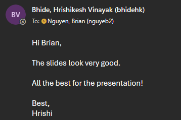

# BarCat Deals: Advisor Feedback

**Course:** CS 5001 - Senior Design I, University of Cincinnati

**Team:** Brian Nguyen, Kaustubh Mathur, Ved Sanap, Meredith Bartel, Kiki Vasilev

**Advisor:** Dr. Hrishikesh Vinayak Bhide

## Meeting Record

- **Date:** November 16, 2026.
- **Format:** Email review.
- **Participants:** Dr. Bhide sent the feedback to Brian Nguyen.
- **Duration:** Not recorded; feedback was provided by email.
- **Presentation reviewed:** The original 11-slide [Senior-Design presentation](Evidence/Reviewed_Presentation.pptx).

## Feedback log

| Slides affected | Advisor feedback | Team response | Change made | Owner | Status |
| --- | --- | --- | --- | --- | --- |
| Entire presentation | Dr. Bhide gave positive feedback on the slides and wished the team success with the presentation. | Accepted the positive feedback. No revisions were requested. | None. | Brian Nguyen | Complete; feedback documented. |

## Summary of Changes

No changes were made in response to the advisor's feedback because the advisor did not request any changes.

## Open Items

There are no open items resulting from the advisor's feedback.
