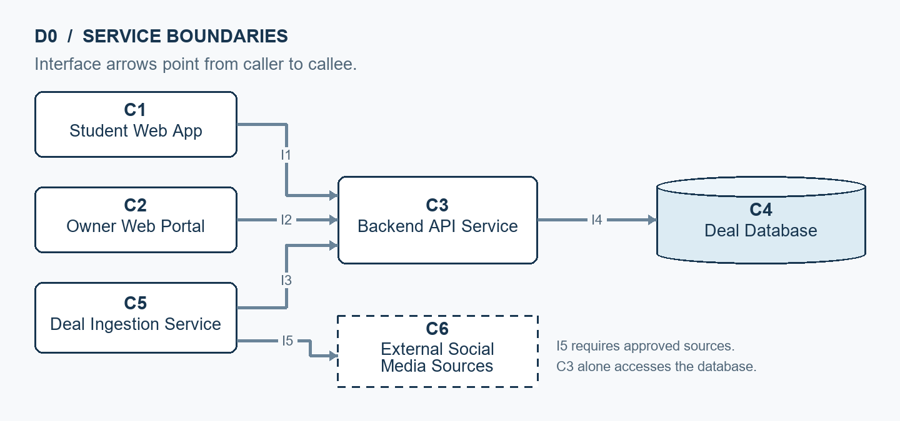

# BarCat Deals

Final Design Report · CS 5001 Senior Design I · University of Cincinnati

**Design baseline assembled November 23, 2026.** The repository documents the design and test procedures for CS 5002. Implementation and acceptance testing are pending. The effort and self-assessment sections identify the records still needed for submission.

## Contents

1. [Team Names and Project Abstract](#1-team-names-and-project-abstract)
2. [Project Description](#2-project-description)
3. [User Stories and Design Diagrams](#3-user-stories-and-design-diagrams)
4. [Project Tasks and Timeline](#4-project-tasks-and-timeline)
5. [ABET Concerns Essay](#5-abet-concerns-essay)
6. [PPT Slideshow](#6-ppt-slideshow)
7. [Self-Assessment Essays](#7-self-assessment-essays)
8. [Professional Biographies](#8-professional-biographies)
9. [Budget](#9-budget)
10. [Appendix](#10-appendix)

## 1. Team Names and Project Abstract

**Team** · Brian Nguyen, Kaustubh Mathur, Ved Sanap, Meredith Bartel, and Kiki Vasilev (Computer Science)

**Faculty advisor** · Dr. Hrishikesh Vinayak Bhide, Computer Science

**Abstract**

BarCat Deals is a planned web app that brings food and bar specials within one mile of UC's main campus into a single feed. Students browse without an account and confirm they are 21 or older to see alcohol offers. Deals show their source and last check. Approved owners submit offers directly, with AI extraction from permitted venue pages as a conditional supplement.

## 2. Project Description

Students currently compare specials across venue accounts with inconsistent descriptions, schedules, and prices. A single feed lets visitors see eligible offers for the current Eastern day in start-time order, including later offers and those continuing past midnight. Deal details display venue, price text, times, provenance, and freshness. Food is prominent, and alcohol visibility depends on server-held guest self-attestation.

Approved owners can publish through a dedicated portal even if they rarely post online. Conditional background extraction adds coverage when source permission, funding, and quality are established. Owner submissions and synthetic test fixtures support implementation before any live automation.

The [Project Description](Project-Description.md) gives the background, alternatives, stack, and team approach.

## 3. User Stories and Design Diagrams

| Story | Need | Acceptance path |
| --- | --- | --- |
| US-01 · Student 21+ | Compare today's nearby food and bar specials with trustworthy details. | UC-01, AC-01.1/3 → REQ-01/03/04, NFR-01 |
| US-02 · Student under 21 | Find food while alcohol offers stay hidden. | AC-01.2 → REQ-02/08, CON-03 |
| US-03 · Venue owner | Make an offer visible without relying on social posting. | AC-03.1 → REQ-05/06, NFR-02, CON-02 |
| US-04 · Keyboard or screen-reader user | Read and navigate the same deal information. | AC-04.1 → REQ-03, NFR-04 |

[User Stories and Use Cases](User_Stories.md) records the original criteria. Use [Requirements v0.2](Requirements_Document.md) for behavior and priorities, [Technical Specification v0.5](Technical_Specification.md) for contracts, and the [Test and Validation Plan](Test_Plan.md) for cases, fixtures, and pass criteria.

### Diagram set and conventions

| View | Diagrams | Use during implementation |
| --- | --- | --- |
| D0 · Architecture | [Block diagram](Design_Diagrams/D0_Detailed_Design.md#block-diagram) · [Data-flow diagram](Design_Diagrams/D0_Detailed_Design.md#data-flow-diagram) | Identify services, I1-I5, and the single database access boundary. D0's current views align with the specification. |
| D1 · Base model | [Entity-relationship diagram](Design_Diagrams/D1_Detailed_Design.md#21-entity-relationship-diagram) | Start with venue, owner, base deal and provenance subtypes. D1's bookmark entities are deferred under OQ-05. |
| D2 · Detailed design | [Client flows](Design_Diagrams/D2_Detailed_Design.md#22-c1-student-web-app) · [Relational extensions](Design_Diagrams/D2_Detailed_Design.md#24-c4-data-additions-and-invariants) · [Ingestion states](Design_Diagrams/D2_Detailed_Design.md#27-c5-ingestion-and-c6-adapters) | Implement browsing and submission, session and provenance records, leases, retries, and failure behavior. |

C identifies a component, I an interface, and G a shared module. In D0, rectangles are services, cylinders are stores, and dashed outlines are external dependencies. Block arrows point to callees and data-flow arrows follow payloads. ER diagrams use keys and crow's-foot cardinality. D2 solid arrows show normal paths and dashed arrows show retries or errors.

### Component purpose and ownership

| Component or module | Purpose | Owner |
| --- | --- | --- |
| C1 Student Web App | Renders the Flask/Jinja feed, detail, filters, and guest prompts. | Brian Nguyen |
| C2 Owner Web Portal | Renders owner sign-in and the accessible seven-item submission form. | Kaustubh Mathur |
| C3 Backend API Service | Uses FastAPI to apply shared eligibility and authority rules, validate writes, and transact with C4. | Ved Sanap |
| C4 Deal Database | Stores relational deals, owners, venues, provenance, sessions, and durable work. | Meredith Bartel |
| C5 Deal Ingestion Service | Normalizes approved pages, uses leases and budget checks, and submits AI candidates through C3. | Kiki Vasilev |
| C6 External Social Media Sources | Provides permitted venue pages through the conditional I5 boundary. | External. We maintain the C5 adapters. |
| G1 Authentication and authorization | Verifies owners, stores guest age answers, and enforces session/CSRF controls. | Ved Sanap |
| G2 Notifications | Renders inline status, validation, freshness, and error notices. | Brian Nguyen |
| G3 Configuration | Validates settings and gates source and AI enablement. | Kiki Vasilev |
| G4 Logging and health | Reports health and operational failures with bounded, redacted logs. | Meredith Bartel |

### Requirements traceability matrix

The matrix covers 10 functional requirements, 8 quality requirements, and 5 inherited constraints. A/B/C lists distinct cases. Cases TC-009 and TC-018 have procedures in [Test Plan Appendix B](Test_Plan.md#appendix-b-deferred-could-procedures) and are deferred. Every case below is planned. See the [test procedures](Test_Plan.md#4-test-cases) and [release criteria](Test_Plan.md#6-pass-and-fail-criteria).

| ID | Priority | Design element | Planned test cases |
| --- | --- | --- | --- |
| REQ-01 | Must | C3 B2 Eastern-day overlap, one-mile radius, stable order; C1 feed | TC-001A, TC-001B, TC-001C |
| REQ-02 | Must | G1 WEB_SESSION and C3 B2 eligibility before feed/detail serialization | TC-002A, TC-002B, TC-002C |
| REQ-03 | Must | C1 DealView facts and source display; C4 DEAL_SOURCE | TC-003A, TC-003B, TC-003C |
| REQ-04 | Must | C3 matching-set freshness metadata and G2 stale/unknown labels | TC-004A, TC-004B, TC-004C |
| REQ-05 | Must | C2 seven-item form, C3 venue authority/validation, C4 atomic write | TC-005A, TC-005B, TC-005C |
| REQ-06 | Should | C3 idempotency and venue lock; C4 REQUEST_RESULT, 24 hours | TC-006A, TC-006B, TC-006C |
| REQ-07 | Should | C5 A2 extraction; C6/I5; C3 validation and C4 post/evidence uniqueness | TC-007A, TC-007B, TC-007C |
| REQ-08 | Should | C1 food filter; C3 I1 filters and signed cursors | TC-008 |
| REQ-09 | Could | C3 B2 active interval and food/remaining minutes/ID ordering | TC-009 (deferred) |
| REQ-10 | Should | C3 G3 settings and G4 live/ready endpoints | TC-010 |
| NFR-01 | Must | C3 B2 indexes, C1 first render, G4 latency evidence | TC-011A, TC-011B, TC-011C |
| NFR-02 | Must | C2 committed publication, C1 revalidation; OQ-07 timing budget | TC-012A, TC-012B, TC-012C |
| NFR-03 | Must | G1 role/session/CSRF, HTTPS, C3 public DTOs and G4 redaction | TC-013A, TC-013B, TC-013C |
| NFR-04 | Must | C1 semantic templates, keyboard controls and G2 accessible notices | TC-014A, TC-014B, TC-014C |
| NFR-05 | Should | C5/C3 I3 claims, lease expiry, retries, durable results (D2 Figure 3) | TC-015A, TC-015B, TC-015C |
| NFR-06 | Should | C4 managed backup and isolated restore | TC-016 |
| NFR-07 | Should | G4 log buffer, retention, and drop reporting | TC-017 |
| NFR-08 | Could | C3 B2 load path with D1 stretch fixture volume | TC-018 (deferred) |
| CON-01 | Constraint | G3 funded settings, C3 reservation gate and C4 BUDGET_RESERVATION | TC-019 |
| CON-02 | Constraint | C2/I2 direct publication and C4 SUBMITTED_DEAL | TC-020 |
| CON-03 | Constraint | C1 food access, G1 minimal session and C3 server age gate | TC-021 |
| CON-04 | Constraint | C5 approved source controls at C6/I5 | TC-022 |
| CON-05 | Constraint | C3-only C4 credentials, controlled migrations and I3/I4 boundary | TC-023 |

The [D2 story-level crosswalk](Design_Diagrams/D2_Detailed_Design.md#4-requirements-traceability-table) traces the earlier US/AC criteria and EC error cases. Its CON-ECON, CON-SOCIAL, and CON-ETHICAL labels correspond to CON-01, CON-02, and CON-03. The matrix above uses the Week 9 IDs, with CON-04/05 added by that baseline. [Specification Section 6](Technical_Specification.md#6-traceability-matrix) gives the matching design references.

### Implementation readiness

The least certain element is live ingestion (OQ-01/04). We need a permitted fetch for each enabled adapter, confirmation of source limits, and funding for hosting, identity, and AI. We propose testing extraction against 100 unseen labeled posts. At least 95% of published offers must be correct, with zero wrong alcohol, time, or price details and at least one published offer. We will keep collection and AI publication disabled until we record the evidence and approvals. We will test the owner-only fallback through TC-020.

We need to verify campus and venue coordinates (OQ-02) and agree with stakeholders on how optional owner prices fit the original price criterion (OQ-03). We have deferred bookmarks and the moderation dashboard (OQ-05). We need to reconcile the project plan and constraints (OQ-06) and settle the proposed performance profile (OQ-07). We will report the written baseline of 95/100 loads under three seconds alongside the proposed 100/100 target. We will test a proposed 30-second visible-feed refresh against the full 60-second owner submission-to-display limit. See the [open-question register](Requirements_Document.md#92-open-questions-and-deferred-decisions) for approval status.

## 4. Project Tasks and Timeline

The [Task List](Planning/Tasklist.md) names the 25 primary owners and the [Planning Package](Planning/Planning.pdf) gives dates, dependencies, risk register, work breakdown, and **estimated** effort. Use task IDs from the task list and timeline tables. The WBS in the older planning PDF carries a numbering discrepancy for tasks 15-22.

| Planned gate | Date | Work and verification |
| --- | --- | --- |
| S00/S01 | Jan 11/25, 2027 | Confirm scope and funding. Start tasks 06-10 with migrations, representative seed data, API contracts, fixture-backed clients, and a normalized adapter fixture. |
| S02/S03 | Feb 9/24 | Integrate authorization, durable ingestion and staging (11, 14, 16), then exercise live clients and owner submission end to end (12, 13, 18). |
| S04/S05 | Mar 10/24 | Run owner failure, schedule/radius and accessibility cases (15, 17, 19). Review defects and corrections at the post-break checkpoint. |
| S06/S07 | Apr 5/12 | Exercise restore and owner/student acceptance (20-23). Require Must and constraint evidence with release blockers addressed. |
| S08-S10 | Apr 19-30 | Record automation decision (24), hand over deployment and recovery (25), and demonstrate the integrated release scope. |

## 5. ABET Concerns Essay

The [Constraints Essay](Constraints.md) and [Ethics and Responsible-Use Statement](Ethics_Statement.md) document the economic, social, ethical, privacy, and accessibility concerns. Funding is a release constraint because hosting and AI usage can incur recurring costs. Direct owner submission supports venues with limited social posting. Prominent food choices, server-held 21+ self-attestation, and minimal session data address the risks of advertising alcohol to a campus audience. Provenance and freshness labels make uncertainty visible.

The design also calls for source permission, notice and consent, restricted retention, revocation, redacted logs, accessibility checks, and hold-back of uncertain AI output. See the [third-party notices](NOTICE.md) and the [November 11 repository security audit](Security_Audit.md) for the recorded scope of those checks.

**Generative AI disclosure.** The team previously documented AI assistance with wording, diagrams, and formatting. Codex assisted with organizing this report, reconciling existing design references, reconstructing notebook evidence from repository records, and exporting PDFs. The report records prior design decisions, open proposals, and source evidence. Personal analysis, assessment ratings, hour attestations, and design approvals require the respective authors.

## 6. PPT Slideshow

[Presentation PowerPoint](Presentation/Senior-Design-Presentation.pptx) · [Slides PDF](Presentation/Senior-Design-Presentation.pdf) · [Run sheet and rehearsal log](Presentation/Run_Sheet.md) · [Advisor feedback](Presentation/Advisor_Feedback.md)

## 7. Self-Assessment Essays

The public record links each member's design notebook and contribution summary.

| Author | Notebook and evidence summary |
| --- | --- |
| Brian Nguyen | [Nguyen notebook](notebooks/nguyen_notebook.md#contribution-summary) |
| Kaustubh Mathur | [Mathur notebook](notebooks/mathur_notebook.md#contribution-summary) |
| Ved Sanap | [Sanap notebook](notebooks/sanap_notebook.md#contribution-summary) |
| Meredith Bartel | [Bartel notebook](notebooks/bartel_notebook.md#contribution-summary) |
| Kiki Vasilev | [Vasilev notebook](notebooks/vasilev_notebook.md#contribution-summary) |

## 8. Professional Biographies

[Brian Nguyen](Professional-Biographies/Brian-Nguyen.md) · [Kaustubh Mathur](Professional-Biographies/Kaustubh%20Mathur%20Professional%20Biography.md) · [Ved Sanap](Professional-Biographies/Ved%20Sanap%20Professional%20Biography.md) · [Meredith Bartel](Professional-Biographies/Meredith-Bartel.md) · [Kiki Vasilev](Professional-Biographies/Vasilev_Assignment-1_Professional_Biography.md)

## 9. Budget

As of November 23, 2026, we have incurred no project expenses and received no donated items or credits. We plan to use a Claude plan and have yet to confirm a budget.

## 10. Appendix

### References and repository

- [Project repository](https://github.com/BrianN45/Senior-Design) and [design evidence history through November 18](https://github.com/BrianN45/Senior-Design/commits/a1785e5/).
- [Requirements glossary and open questions](Requirements_Document.md#9-assumptions-and-open-questions), [technical contracts](Technical_Specification.md#3-interfaces-and-data-formats), and [Test Plan Appendix A references](Test_Plan.md#appendix-a-supporting-sources).
- [Test and Validation Plan](Test_Plan.md) links stories to planned cases and identifies release evidence. The earlier [Week 10 PDF](Test_Plan.pdf) records the original design snapshot.
- [Constraints essay](Constraints.md), [ethics statement](Ethics_Statement.md), [third-party attribution and terms](NOTICE.md), and [project license](LICENSE).

### Meeting and review records

We began meeting September 16. Our [Team Contract](Team_Contract.md) sets Wednesdays at 3 p.m. in Clifton Court Hall, with 1-2 hours scheduled. We reconstructed likely agendas from commits and project records.

| Wednesday | Reconstructed agenda or planned work | Supporting record |
| --- | --- | --- |
| Sep 16 | Set our meeting schedule, clarify the problem of comparing nearby specials, and review economic, social, and ethical constraints. | [Team contract commit](https://github.com/BrianN45/Senior-Design/commit/d3b8c56) · [Project scope commit](https://github.com/BrianN45/Senior-Design/commit/ae74784) |
| Sep 23 | Refine student and owner stories, walk through the browse flow, and define acceptance checks for age, freshness, and accessibility. | [User stories commit](https://github.com/BrianN45/Senior-Design/commit/cb9dbd4) |
| Sep 30 | Sketch our D0 service boundaries and I1-I5, and trace how owner submissions and venue posts enter the feed. | [D0 commit, Oct 2](https://github.com/BrianN45/Senior-Design/commit/53a1aa7) |
| Oct 7 | Review D1's deal model, shared backend contracts, and the choice of PostgreSQL for durable background jobs. | [D1 commit](https://github.com/BrianN45/Senior-Design/commit/2078264) · [Backend revisions](https://github.com/BrianN45/Senior-Design/commit/d4aecd8) |
| Oct 14 | Walk through D2 client and ingestion flows. Record peer review actions on source access, feed behavior, edge cases, references, and AI quality. | [D2 commit](https://github.com/BrianN45/Senior-Design/commit/f2eb33b) · [Peer review notes](Design_Diagrams/Peer_Review_Notes.md) |
| Oct 21 | Follow up on our five peer review actions. Check access evidence, the today-versus-active example, and the proposed AI evaluation. | [Scheduled review follow-up](Design_Diagrams/Peer_Review_Notes.md#feedback-and-action-items) |
| Oct 28 | Align requirement IDs and interfaces, assign tasks and milestones, and record owners for open decisions. | [Requirements and spec commit](https://github.com/BrianN45/Senior-Design/commit/38e9256) · [Task list commit](https://github.com/BrianN45/Senior-Design/commit/3e08bf3) |
| Nov 4 | Map tests to requirements and review fixtures for age gating, schedule limits, accessibility, and owner publication timing. | [Test plan commit](https://github.com/BrianN45/Senior-Design/commit/6a4350b) |
| Nov 11 | Review our responsible-use controls for alcohol offers, data retention, source permission, and credential handling. | [Ethics and audit commit](https://github.com/BrianN45/Senior-Design/commit/e33d2ff) |
| Nov 18 | Check our slide order, speaking handoffs, timing, and anticipated questions. Record advisor feedback. | [Run sheet commit](https://github.com/BrianN45/Senior-Design/commit/1a6d03a) · [Advisor feedback](Presentation/Advisor_Feedback.md) |
| Nov 25 | Planned slot. Compare our report and notebook entries with the repository and identify missing effort evidence. | [Design notebook evidence](#individual-effort-evidence) |
| Dec 2 | Planned slot. Review the report, confirm individual submission materials, and check the status of the signed advisor form. | [Report contents](#contents) |

### Individual effort evidence

We estimate **2-3 hours per member per week**, or **28-42 hours over Weeks 1-14**. Weeks 13-14 are projections.

| Member | Contribution records | 14-week estimate |
| --- | --- | --- |
| Brian Nguyen | [D2 and peer review](https://github.com/BrianN45/Senior-Design/commit/f2eb33b) · [Test Plan](https://github.com/BrianN45/Senior-Design/commit/6a4350b) · [Notebook](notebooks/nguyen_notebook.md) | 28-42 h |
| Kaustubh Mathur | [User stories](https://github.com/BrianN45/Senior-Design/commit/cb9dbd4) · [D1 revisions](https://github.com/BrianN45/Senior-Design/commit/d4aecd8) · [Notebook](notebooks/mathur_notebook.md) | 28-42 h |
| Ved Sanap | [Biography contribution](https://github.com/BrianN45/Senior-Design/commit/54501dc) · [PR-01 assignment](Design_Diagrams/Peer_Review_Notes.md#feedback-and-action-items) · [Notebook](notebooks/sanap_notebook.md) | 28-42 h |
| Meredith Bartel | [Biography contribution](https://github.com/BrianN45/Senior-Design/commit/f380900) · [PR-04 assignment](Design_Diagrams/Peer_Review_Notes.md#feedback-and-action-items) · [Notebook](notebooks/bartel_notebook.md) | 28-42 h |
| Kiki Vasilev | [Project description](https://github.com/BrianN45/Senior-Design/commit/ae74784) · [PR-02 assignment](Design_Diagrams/Peer_Review_Notes.md#feedback-and-action-items) · [Notebook](notebooks/vasilev_notebook.md) | 28-42 h |
